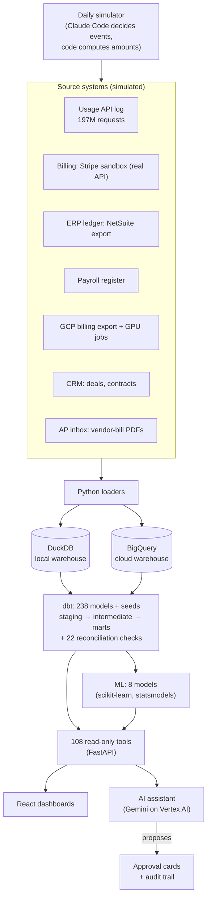
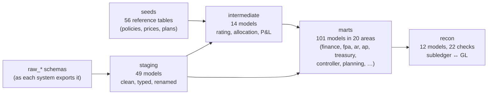
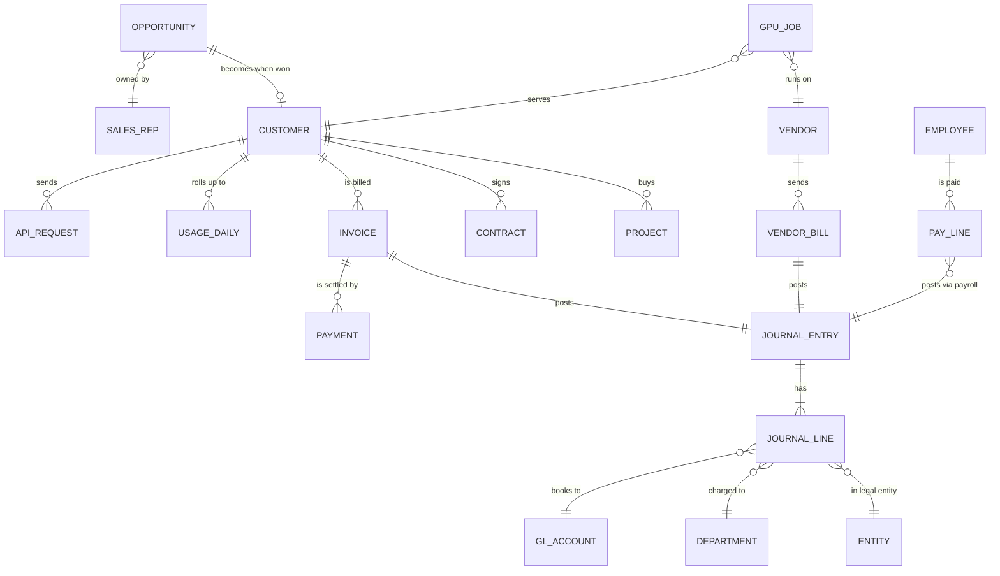
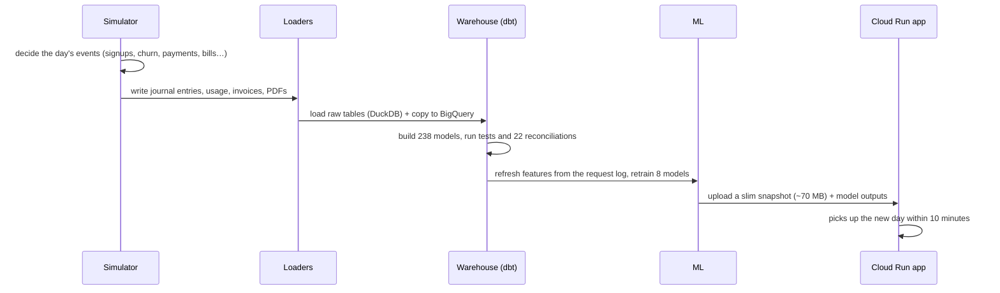
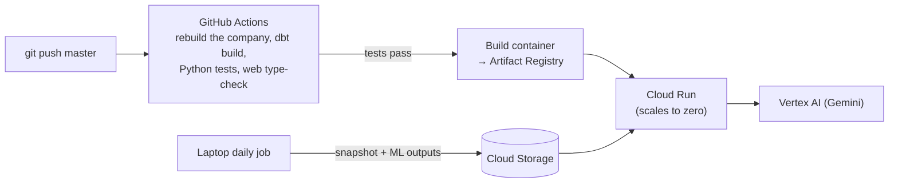

# Finance OS

**One trusted view of a company's finances: every number defined, reconciled to its source, and explained.**

Finance OS is a finance workspace for **Echo Labs**, a simulated voice-AI company. It brings the ledger, billing,
payroll, cloud and GPU costs, CRM and contracts into one governed warehouse, then turns it into dashboards, forecasts,
machine-learning predictions and an AI assistant that answers only from the data.

**Live demo:** https://finance-os-905768726552.us-central1.run.app
(the first load can take ~20 seconds while the demo server wakes up; a guided tour starts on the first visit)

> The company and every figure in it are simulated. The problems it models, and the way it solves them, are real.

---

## Contents
1. [Why it exists](#1-why-it-exists)
2. [What it does](#2-what-it-does)
3. [How it helps: three examples](#3-how-it-helps-three-examples)
4. [Architecture](#4-architecture)
5. [Stack, and why](#5-stack-and-why)
6. [Data model](#6-data-model)
7. [How it works](#7-how-it-works)
8. [Trust: how the numbers are kept honest](#8-trust-how-the-numbers-are-kept-honest)
9. [Deployment and CI/CD](#9-deployment-and-cicd)
10. [Run it locally](#10-run-it-locally)
11. [Repository layout](#11-repository-layout)
12. [Limits, stated plainly](#12-limits-stated-plainly)
13. [License, privacy and terms](#13-license-privacy-and-terms)

---

## 1. Why it exists

Most finance decisions are not hard. Getting a trustworthy picture is. Margin sits in one spreadsheet, cloud costs in
a billing console, cash in the bank portal, customer health in the CRM and the budget in a deck. By the time it is
stitched together the moment has passed, and the decision is made on instinct.

Finance OS puts the whole picture in one place, and is built around three habits:

| Habit | What it means in the product |
|---|---|
| **Define what a number is for before building it** | Every KPI has a definition, owner, threshold and the decision it supports ([metric catalog](docs/METRIC_CATALOG.md)) |
| **Stay skeptical until it reconciles** | 22 reconciliation checks tie every subledger and the bank statements to the GL; the warehouse runs on two engines that must agree to the cent |
| **An unexplained variance is a problem, not noise** | Every budget variance opens a case file: the source lines, the reconciliation, the root cause, the owner and the decision |

## 2. What it does

| Area | What you get |
|---|---|
| **Overview** | Home scorecard with context (vs last month, budget, last year, benchmark), CEO one-pager, Decision KPIs with status and owners, an Explore tool for any slice of the ledger, three-statement financials in a spreadsheet view with Excel export |
| **Plan & cash** | Driver-based 18-month forecast (base / upside / downside), five-year plan, scenarios and stress tests, **8 ML models** (Predictions page), corporate finance (ratios, DuPont, WACC, project NPV/IRR, **company valuation**: DCF, peers, football field), 13-week cash forecast, **treasury** (debt facilities, covenants, FX hedging, receivables financing: credit-line borrowing base and invoice factoring), cap table and fundraising, pricing |
| **Revenue** | Unit economics by product and customer, ARR/NRR/churn and cohorts, pipeline and sales capacity, contracts and remaining performance obligations, a **deal desk** that prices from real unit costs and routes only non-standard deals, **sales commissions** (statements, accelerators, clawbacks, disputes), billing, receivables and collections |
| **Spend** | GPU and cloud spend with tag attribution, idle capacity and commitments, AP inbox that reads vendor-bill PDFs and checks them against POs and the ledger, department budgets vs actuals, project accounting |
| **Close & control** | Month-end close checklist with evidence, **bookkeeping** (bank statements reconciled to GL cash, manual journal entries that post only after approval, trial balance, ERP import export), **controller** tools (fixed-asset register reconciled to the GL, ASC 842 leases, ASC 718 stock-based compensation, ASC 740 income tax provision with deferred taxes and the rate reconciliation, journal-entry testing), multi-entity consolidation, tax and FX, data trust |
| **Assistant** | Ask anything in plain English. It calls 114 read-only warehouse tools, shows every step and its sources, and anything that would change data becomes an approval card for a person to approve or reject |

Every card has an **ⓘ**: hover it to see what the card shows and which tables its data comes from.

## 3. How it helps: three examples

**"Why is revenue 29% under budget?"** One click on the variance opens its case file. The number traces down through
**12.6M API requests → 3,989 daily usage rows → 75 usage invoices → 75 journal lines**, the reconciliation shows it
ties, and the root cause is named: the budget assumed growth the usage never delivered. An owner and a decision come
with it.

**"Is 7% revenue growth good news?"** On the same screen: the top 20% of customers produce 98% of gross margin, runway
is 5+ years without new money, the churn model ranks who is likely to leave, and the payment model says when the big
invoices will actually be paid. The conversation moves from *what are the numbers* to *what should we do*.

**"Should we draw the venture debt?"** Treasury shows the $5M term loan would cost $45.8K a month in interest, and at
today's burn it would *shorten* runway (138 → 128 months), with every covenant shown against its threshold.

## 4. Architecture



The same dbt project builds on **DuckDB** (fast, local, free) and **BigQuery** (cloud scale); a parity check proves
both produce identical results.

## 5. Stack, and why

| Layer | Choice | Why |
|---|---|---|
| Warehouse (local) | **DuckDB** | A full analytical warehouse in one file: the 197M-row company builds on a laptop, at no cost |
| Warehouse (cloud) | **BigQuery** | The same models at cloud scale; tested on a 2,000-customer, 591M-request version of the company |
| Transformation | **dbt** | Version-controlled SQL with tests, documentation and lineage; cross-database macros keep one codebase for both engines |
| Language | **Python 3.14** | Loaders, simulator, tools, ML and the API in one language |
| ML | **scikit-learn, statsmodels** | Gradient boosting, logistic regression, isolation forests and ETS: interpretable, well understood, and backtested against the methods they replace |
| API | **FastAPI** | Typed, fast, and the same tools serve both the dashboards and the assistant, so they always show the same numbers |
| Front end | **React + TypeScript + Vite + Recharts** | Interactive, cross-filtering dashboards; mobile layout; guided tour |
| AI assistant | **Gemini 2.5 Flash on Vertex AI** | Tool calling at about $0.005 a question; tested on 111 questions (95% pass); authenticates with the cloud service account, so no API keys |
| Data generation | **Claude Code** (headless) | Decides each day's business events; code validates them and computes every amount |
| Hosting | **Google Cloud Run** | Scales to zero when idle: a portfolio demo that costs about $0–2 a month |
| CI/CD | **GitHub Actions** + Workload Identity Federation | Every push to `master` rebuilds the company, runs all tests, then deploys, with no stored credentials |

## 6. Data model

**Layers.** Raw source tables are cleaned in *staging*, combined in *intermediate* models, and published as *marts*
that the product reads. Reconciliation models check the marts against their sources.



**Core entities** (simplified; the full lineage is in dbt's docs):



**Scale.** The same generator produces two sizes of Echo Labs:

| | **S** (live demo) | **L** (scale test) |
|---|---|---|
| Customers | 116 | 2,000 |
| API requests | 196M | 591M |
| Journal entries | 4,307 | 58,772 |
| Timeline | Jan 2025 → today, extended every morning | Jan 2025 → Sep 2026, generated once |
| Where | DuckDB + BigQuery (`s_` datasets) | BigQuery |

Altogether the BigQuery warehouse holds about **795M rows (107 GB)**.

## 7. How it works

**Every morning** (7:00, on the laptop) the company moves forward one day and everything downstream refreshes:



**The assistant** reads only through tools, so every number in an answer comes from the warehouse. A validator flags
any number in an answer that a tool did not return; an evidence block lists the sources; a daily question cap keeps
the public demo affordable. Actions (rejecting a duplicate bill, fixing a misapplied payment, submitting a deal,
disputing a commission) are proposals: a person approves or rejects them, with an audit trail.

**The machine-learning models** each sit next to the method they would replace, with the backtest shown:

| Model | Method | Result vs today's method |
|---|---|---|
| Churn (3 months) | logistic regression on weekly snapshots, 29 features incl. the API log | ROC AUC 0.72 vs 0.54 for the health rules |
| Expansion | gradient boosting | 0.75 vs 0.61 for a usage-trend rule |
| Payment timing | quantile gradient boosting | 3.65 days error vs 3.79 (6.1 vs 7.6 on invoices ≥ $10K) |
| Cost anomalies | robust z-score + isolation forest | caught 12/12 planted anomaly periods vs 10/12 |
| Revenue (bottom-up) | gradient boosting per customer | best one month out; ETS better further out |
| Usage revenue | ETS time series | driver forecast was more accurate, and the page says so |
| GPU & cloud spend | gradient boosting | growth method slightly more accurate |
| Deal win | logistic regression | no signal with 56 closed deals; CRM stage weighting stays |

Two of these lost to the simpler method. The product shows that, rather than hiding it.

## 8. Trust: how the numbers are kept honest

- **Reconciliations:** GL revenue vs rated usage, Stripe invoices and balance vs GL, payroll register vs GL, vendor
  bills vs AP, GCP billing export vs the bill, request events vs daily drivers (to the millisecond), and more. 19
  checks, every month.
- **Two engines, one answer:** `python -m finance_os.warehouse_parity` compares every model on DuckDB and BigQuery. Today: **175 models, 0 differences**. Money never passes through a float.
- **Closed months only:** monthly views stop at the last closed month; the open month has its own projected view.
- **Leakage checks:** the ML tests fail if a model scores implausibly well (the deal model once scored a perfect 1.00
  because the CRM assigns a customer ID only after a win).
- **Tests:** 122 Python tests, hundreds of dbt tests, and 111 assistant questions with expected tools and values.

## 9. Deployment and CI/CD



- **Two GCP projects:** `finance-os-sivaram` holds the data (BigQuery); `finance-os-app-sivaram` runs the app.
- **No key files anywhere:** GitHub signs in through Workload Identity Federation; the app uses its service account.
- **Cost:** about $0–2 a month (Cloud Run scales to zero; Gemini about $0.005 a question, capped at 50 a day).

## 10. Run it locally

```bash
python -m venv .venv
.venv/Scripts/pip install -e ".[dev]"
.venv/Scripts/python -m finance_os.generator                    # generate the company → data/synthetic/
.venv/Scripts/python -m finance_os.ingestion.synthetic_loader  # load DuckDB → data/finance_os.duckdb
cd warehouse && ../.venv/Scripts/dbt build --profiles-dir . && cd ..
.venv/Scripts/python -m pytest -q
```

Run the app (API on :8000, web on :5173):

```bash
.venv/Scripts/python -m finance_os.app
```
```bash
npm --prefix web install && npm --prefix web run dev
```

The full command reference (BigQuery, the daily job, ML training, the assistant tests) is in the
[developer guide](docs/DEVELOPER_GUIDE.md); the design is in [docs/SYSTEM_DESIGN.md](docs/SYSTEM_DESIGN.md).

## 11. Repository layout

```
src/finance_os/
  generator/      the simulated company (history) and request-level usage events
  simulator/      the daily simulation (live days)
  ingestion/      loaders: CSV, live records, Stripe, AP PDFs, BigQuery copy
  ml/             feature store and the 8 models
  app/            FastAPI app, 108 tools, assistant, cloud entry point
  reports/        invoice PDFs, board pack, scheduled reports
  corpfin.py      corporate-finance formulas (DCF, WACC, NPV, …)
warehouse/        dbt project: models (staging, intermediate, marts, recon), seeds, macros, metric definitions
web/              React front end
tests/            Python tests
evals/assistant/  assistant test questions and results
docs/             system design, metric catalog, processes, developer guide
```

## 12. Limits, stated plainly

- The company is **simulated**. Stripe is a real sandbox API; the ERP, payroll and CRM data follow real export formats but are generated.
- Some reference inputs are **illustrative and labelled so**: lease terms, lender terms, FX hedges and peer valuation multiples.
- Leases, debt and hedges are subledger schedules; the Controller page shows the entries to book rather than posting them.
- The live demo serves the S company; the L company proves the pipeline at scale but is not updated daily.
- Assistant answers can be wrong. They cite their sources so they can be checked.

## 13. License, privacy and terms

- **License:** [Apache License 2.0](LICENSE)
- **Privacy:** [PRIVACY.md](PRIVACY.md): what the demo stores and processes
- **Terms of use:** [TERMS.md](TERMS.md)
