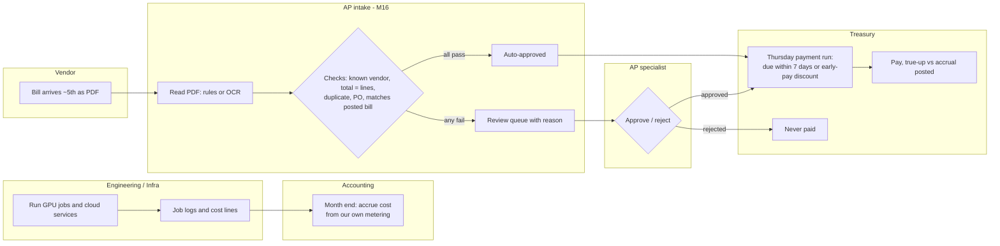
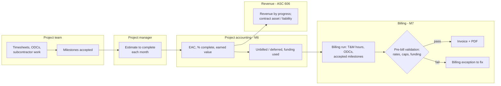

# Finance processes at Echo Labs (M15)

How money moves through Echo Labs, who does what, and what Finance OS automates. Every step names the model, tool or
job that performs or checks it, so this document stays true to the system. Process maps are swim lanes (one lane per
role or system); diagrams render on GitHub.

Contents: [Quote-to-cash](#1-quote-to-cash) · [Procure-to-pay](#2-procure-to-pay) ·
[Project billing](#3-project-billing) · [Month-end close](#4-month-end-close) · [Controls](#5-controls) ·
[Before and after](#6-before-and-after)

---

## 1. Quote-to-cash

```mermaid
flowchart LR
  subgraph Sales
    A[Build deal: products, volume,<br/>discount, term, commit] --> B{Deal desk check}
  end
  subgraph DealDesk[Deal desk - finance_os.dealdesk]
    B -->|inside guardrails| C[Auto-approved, audited]
    B -->|outside guardrails| D[Approval card to Finance<br/>with reasons]
  end
  subgraph Finance
    D --> E{Approve / reject}
  end
  subgraph Customer
    C --> F[Signs quote and order form PDF]
    E -->|approved| F
    F --> G[Uses the API daily]
  end
  subgraph Billing[Billing - usage rating, Stripe]
    G --> H[Usage metered: request events<br/>rolled up and reconciled]
    H --> I[1st of month: invoice last month<br/>at price book + tiers]
    I --> J[Card charged / invoice on terms]
  end
  subgraph AR[Accounts receivable]
    J --> K{Paid by due date?}
    K -->|no| L[Collections queue, drafted reminders<br/>approved before sending]
    K -->|yes| M[Cash applied to the invoice]
    L --> M
  end
  subgraph GL[General ledger - NetSuite]
    I --> N[Dr AR / Cr usage revenue]
    M --> O[Dr cash / Cr AR, Stripe fee to COGS]
  end
```

| SIPOC | |
|---|---|
| **Suppliers** | Sales reps, customers, Stripe, the API metering pipeline |
| **Inputs** | Deal terms, price book and volume tiers (`seeds`), request events (`raw_usage.api_requests`), Stripe charges and payouts |
| **Process** | Deal desk → order form → usage metering → monthly rating and invoicing → collection → cash application |
| **Outputs** | Approved quotes (`/api/deals/{id}/quote.pdf`), invoices, cash receipts, revenue and AR in the GL, commission credits |
| **Customers** | Customers, VP Finance (revenue, DSO), Sales (commissions), auditors |

Checks along the way: `recon_usage_events` (events = drivers to the millisecond), `recon_gl_revenue` (GL revenue =
rated usage), `recon_stripe_revenue_gl` and `recon_stripe_cash_gl` (Stripe = GL), `fct_cash_application_exceptions`
(misapplied payments), alerts AR-60 and MARGIN-FLOOR.

## 2. Procure-to-pay

| SIPOC | |
|---|---|
| **Suppliers** | GCP, Nimbus GPU Cloud, subcontractors, other vendors (legal, software, marketing) |
| **Inputs** | Vendor bill PDFs (`data/inbox/ap`), GPU job logs, cloud cost lines, Google's billing export, vendor contracts and payment terms (`seeds`) |
| **Process** | Accrue at month end → receive and read bill → automated checks → approve (auto or person) → weekly payment run → true-up |
| **Outputs** | Posted bills and payments, accruals and true-ups, payment run proposals (`fct_payment_run_proposal`), review queue |
| **Customers** | Controller (accruals, AP balance), VP Finance (cash), Head of Infra (cloud spend), vendors |

Checks: `fct_ap_documents` routing, `recon_vendor_invoices` (metered vendors' bills vs our cost model, 1%),
`recon_vendor_bills_gl`, `recon_gcp_export_bill` (Google's export = Google's invoice), approval gate in
`simulator/ap_approvals.py` (only approved bills are paid), alerts AP-REVIEW and UNTAGGED.

## 3. Project billing

| SIPOC | |
|---|---|
| **Suppliers** | Delivery staff, subcontractors, PMs, federal contracting officer |
| **Inputs** | Timesheets, contract rates and CLINs, purchase orders, PM estimates, milestone acceptances |
| **Process** | Cost capture → EAC and earned value → pre-bill validation → invoice → ASC 606 revenue and contract balances |
| **Outputs** | Project invoices, `fct_project_financials`, funding notices, `fct_revenue_schedule_monthly` adjustments |
| **Customers** | PMs, enterprise and federal customers, Controller, auditors |

Checks: `fct_billing_exceptions` (over cap, over funding, rate mismatch), `recon_project_billing_gl`,
`recon_project_labor`, `assert_revenue_rollforward_ties`, alerts FUNDING-75/90, TM-CAP-85, UNBILLED.

## 4. Month-end close

```mermaid
flowchart LR
  subgraph WD1[Workday 1]
    C01[C01 Revenue cut-off,<br/>usage invoices] --> C02[C02 Stripe revenue = GL]
  end
  subgraph WD2[Workday 2]
    C03[C03 Stripe cash and payouts] --> C04[C04 Payroll register = GL]
    C04 --> C05[C05 Vendor bills and accruals]
  end
  subgraph WD3[Workday 3]
    C06[C06 Vendor invoices vs metering] --> C07[C07 Project billing = GL]
    C07 --> C08[C08 Project labor = timesheets]
    C08 --> C09[C09 Prepaid amortization]
    C09 --> C12[C12 GCP export = invoice]
  end
  subgraph WD4[Workday 4]
    C10[C10 Budget vs actual review] --> C11[C11 Usage metered vs billed]
  end
  subgraph WD5[Workday 5]
    C13[C13 Controller sign-off<br/>and period lock]
  end
  C02 --> C03
  C05 --> C06
  C12 --> C10
  C11 --> C13
```

### Close runbook

The checklist is `seeds/close_tasks.csv`; `fct_close_status` sets each task's status from the evidence, so the
close status cannot be claimed, only earned. A month closes in the data when it is billed (1st of the next month).

| # | Day | Owner | Task | Evidence (what makes it "complete") | If it fails |
|---|---|---|---|---|---|
| C01 | 1 | Accounting | Cut off revenue, post usage invoices | `gl_revenue_vs_rated_usage` passes | Find the customer-month in `recon_gl_revenue`; re-rate or re-post |
| C02 | 1 | Accounting | Stripe revenue = GL | `stripe_invoices_vs_gl_revenue` passes | Compare Stripe invoice lines to the GL entry |
| C03 | 2 | Accounting | Stripe cash and payouts | `stripe_balance_vs_gl_cash` passes | Look for unbooked fees, refunds or payouts |
| C04 | 2 | Accounting | Payroll register = GL | `payroll_register_vs_gl` passes | Compare `pay_register_lines` to the payroll journal by department |
| C05 | 2 | AP | Vendor bills posted, costs accrued | `vendor_bill_vs_gl_ap` passes; `fct_accruals_monthly` | Book missing accruals; true-up when the bill arrives |
| C06 | 3 | AP | Vendor invoices vs our metering | `vendor_invoice_vs_modeled` within 1% | Dispute with the vendor or correct the cost model |
| C07 | 3 | Project accounting | Project billing = GL | `project_billing_vs_gl` passes | Post the missing invoice |
| C08 | 3 | Project accounting | Labor = timesheets | `project_labor_within_payroll` passes | Fix unapproved or mis-coded timesheets |
| C09 | 3 | Accounting | Prepaid amortization | `fct_prepaid_schedule` covers the month | Post the amortization entry shown |
| C12 | 3 | AP | Google export = Google invoice | `gcp_export_vs_bill` passes | Missing export days, an unbilled credit, or a mis-keyed bill |
| C10 | 4 | FP&A | Explain BvA variances | No open `fct_bva_monthly` alerts (or commentary approved) | Draft and approve commentary from `fct_bva_drivers` |
| C11 | 4 | Controller | Metered vs billed usage | `usage_events_vs_drivers` passes | Lost or double-counted events: investigate the pipeline |
| C13 | 5 | Controller | Sign off, lock the period | Every other task complete | Status shows **blocked** until they are |

Also reviewed at close (not blocking): the ASC 606 adjustment (`fct_revenue_rollforward_monthly.revenue_adjustment`),
working capital, covenants (`fct_treasury_covenants`) and the 13-week cash forecast.

## 5. Controls

| Control | Who decides | Segregation of duties | Automated evidence |
|---|---|---|---|
| Deal pricing outside guardrails | Finance (approval card) | Sales proposes, Finance approves | `dealdesk.evaluate` checks; `actions` + `audit_log` |
| Vendor bill approval | AP specialist (exceptions); rules (clean bills) | The person who approves does not run the payment | `fct_ap_documents` routing; approval actions |
| Vendor payment | Treasury payment run | Only approved bills are payable | `ap_approvals.payable`; `fct_payment_run_proposal` |
| Customer reminders | AR specialist approves each draft | The AI drafts, a person sends | `propose_reminder_decision` cards |
| Cash application fixes | Controller | Proposed by AR / the assistant, approved by the Controller | `propose_cash_application_fix` cards |
| Journal correctness | System | Every entry must balance or it is not posted | `assert_journal_entries_balance` |
| Reconciliations | Controller | Built from independent sources (Stripe, NetSuite, payroll, Google, metering) | `recon_status` (12 checks) |
| Period close | Controller | Cannot sign off with open tasks | `fct_close_status` |
| Commission disputes | Finance | Rep raises, Finance resolves | `propose_commission_dispute` cards |
| Treasury limits | VP Finance, CEO | Alerted, not silently tolerated | `fct_treasury_covenants`, alerts COVENANT / MIN-CASH-13W |
| AI answers | System | Every number in an answer must come from a tool result | `app/validator.py`; 50 eval questions |
| AI actions | A person | The assistant can only propose; nothing executes without approval | `actions` table, `audit_log` |

Alerts (`seeds/alert_rules.csv`, `fct_alerts`) route each exception to its owner once, as a daily digest, and stay in
the alert log until acknowledged or resolved.

## 6. Before and after

Estimated hours per month for a finance team of this size, before (spreadsheets, manual matching) and after
Finance OS. Estimates; the "after" column is the human time that remains (reviews and decisions).

| Step | Before | After | What removed the work |
|---|---:|---:|---|
| Rate usage and build invoices | 16 h | 1 h | Usage rated from metered events; invoices and PDFs generated |
| Stripe and bank reconciliations | 10 h | 0.5 h | `recon_stripe_*` run every morning |
| Vendor bill keying and matching | 12 h | 2 h | AP intake reads PDFs and checks them; only exceptions reach a person |
| Accruals and true-ups | 6 h | 0.5 h | Accrued from our own metering; true-up computed when the bill lands |
| Payroll-to-GL tie-out | 4 h | 0.25 h | Register posted and reconciled automatically |
| Project EAC, WIP and billing prep | 20 h | 4 h | EAC, earned value, unbilled and pre-bill validation computed |
| Collections follow-up | 10 h | 2 h | Ranked queue and drafted reminders |
| Budget vs actual commentary | 8 h | 2 h | Variance drivers found; commentary drafted for approval |
| Close checklist tracking | 6 h | 0.5 h | Task status from evidence |
| 13-week cash and forecast refresh | 12 h | 1 h | Rebuilt every morning from the books |
| Deal approvals | 6 h | 1 h | Guardrails auto-approve the routine ones |
| Commission statements | 8 h | 1 h | Credited from billed revenue with clawbacks |
| **Total** | **118 h** | **15.75 h** | about **100 hours a month** returned to analysis |
