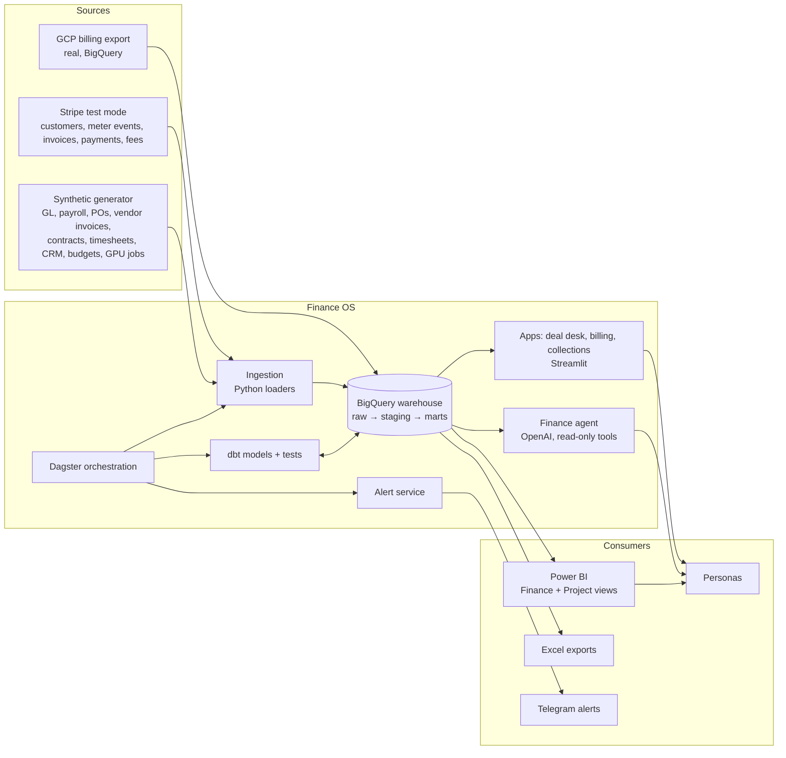
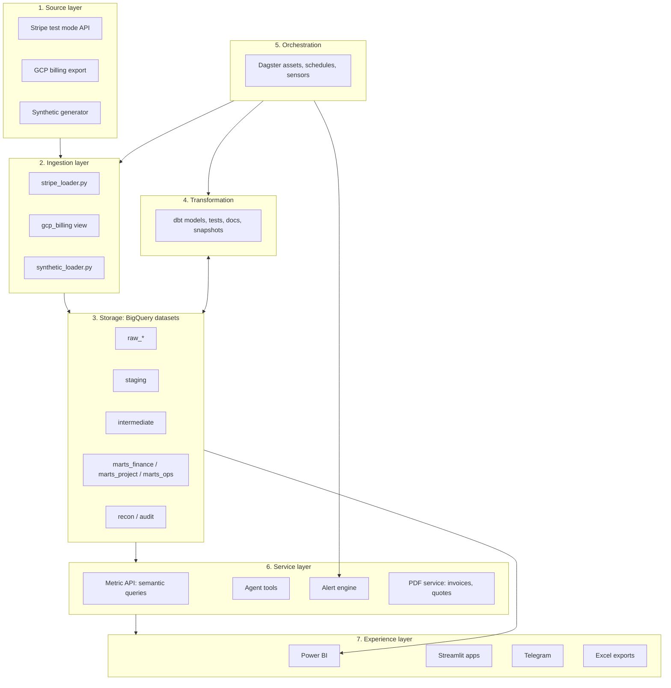
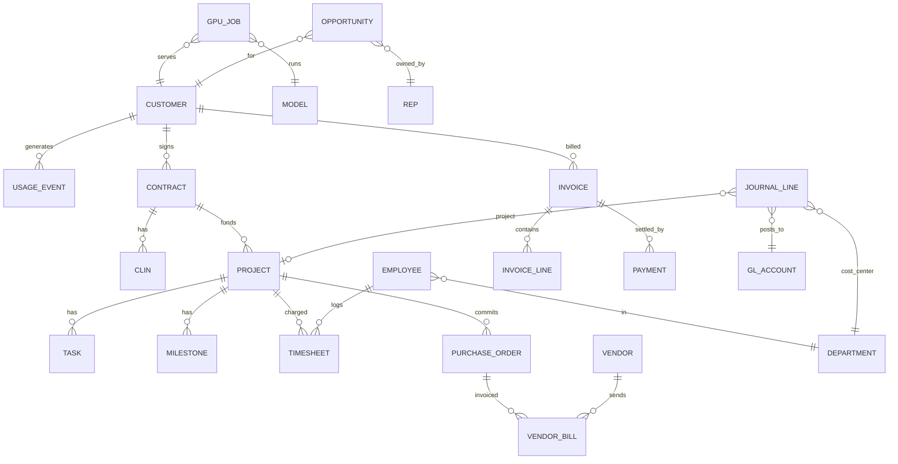
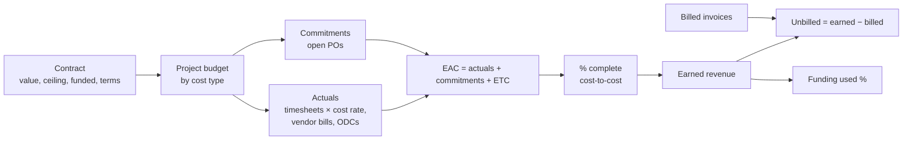
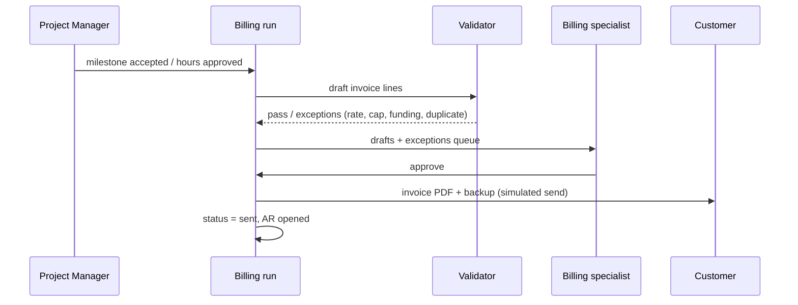
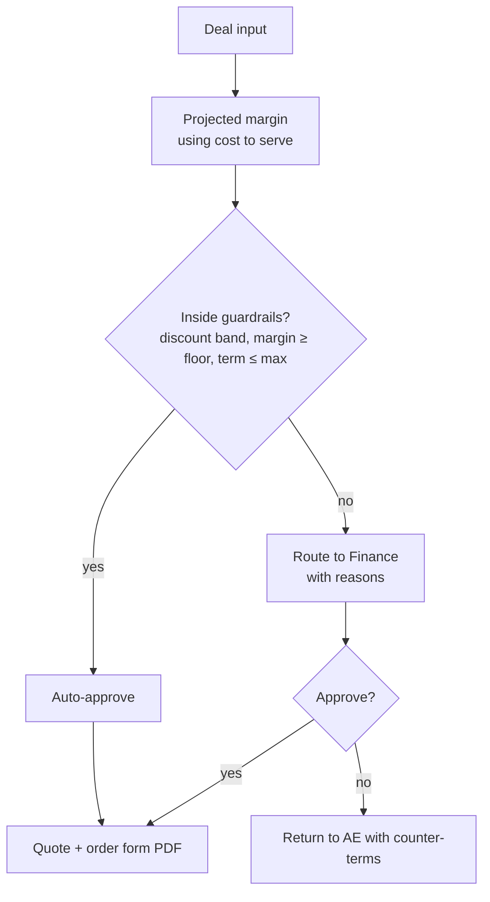
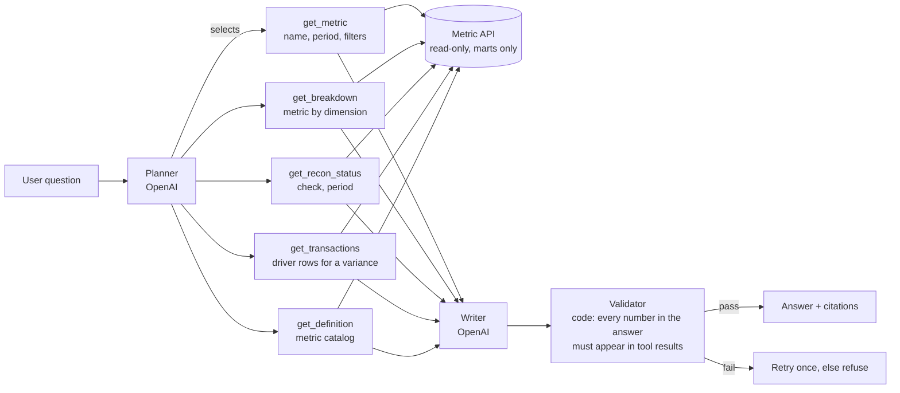
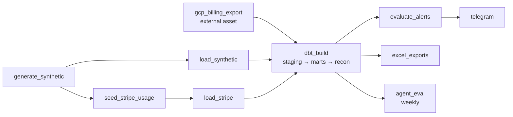

# Finance OS — System Design Document

| | |
|---|---|
| Version | 0.1 (draft for review) |
| Date | 2026-10-17 |
| Owner | Sivaram Vangavolu |
| Status | Design — nothing built yet |

---

## 1. Purpose

Finance OS is a working finance and project-accounting platform for a fictional company, **Echo Labs**. It is built to show, with running code and reconciled numbers, the work done by two kinds of role:

1. **Finance Engineer** (reference: AssemblyAI). Unit economics, tech spend, burn and KPIs, budget vs. actuals, deal desk, sales comp, finance agents, and the data layer underneath them.
2. **Project Accounting / Billing Operations** (reference: a federal-contracting firm). Contracts, project budgets, purchase orders, vendor invoices, commitments, billing, unbilled work, AR and collections, and process documentation.

The guiding rule comes from the AssemblyAI posting: *rebuilt from source data rather than spreadsheets*, and every number reconciles or has its variance explained.

### 1.1 Goals
- G1. One warehouse is the single source of truth. Every dashboard, alert, export and agent answer reads from it.
- G2. Every metric has a written definition: the decision it supports, its formula, its grain and its owner. These are defined before the metric is built.
- G3. Every key number reconciles to an independent source (Stripe ↔ GL, GCP bill ↔ modeled spend, invoices ↔ contract terms), and variances are investigated in writing.
- G4. Manual finance work is automated end to end: daily pipelines, alerts, invoice generation, collection drafts and comp statements.
- G5. AI is used only where it helps (language, summarizing, drafting, explaining) and never to compute money.

### 1.2 Non-goals
- No real customers, real money or real PII. All business data is synthetic, except the GCP billing export (the owner's own real cloud costs).
- No real ERP (NetSuite, SAP). The general ledger is a modeled, ERP-like structure.
- No GAAP or audit certification. Revenue recognition follows simplified, documented policies.
- No production SLA or multi-tenant SaaS.

### 1.3 What this project honestly cannot show
| Gap | Why |
|---|---|
| Non-engineers relying on it daily | There are no real users. The system is demo-able, not adopted. |
| Years of employment in the role | A project can't substitute for tenure |
| Real federal contract experience | The federal contract is simulated, so the project shows understanding, not experience |
| Real NetSuite or SAP | Only Stripe (test mode) and GCP are real systems |
| Finance or accounting degree | Not addressable |
| Real stakeholder management | Simulated personas only |

---

## 2. Traceability to the target roles

Every requirement in §5 carries a tag back to the posting line it serves. `AAI-n` = AssemblyAI, `PA-n` = project-accounting role.

### 2.1 AssemblyAI Finance Engineer
| ID | Posting line | Modules | Coverage |
|---|---|---|---|
| AAI-1 | Unit economics: cost-to-serve, gross margin, contribution by product, customer, workload | M2 | Full |
| AAI-2 | Tech-org budgeting: cloud and GPU attribution, vendor and capacity forecasting | M3 | Full (small scale, real GCP data) |
| AAI-3 | Finance dashboard: burn, runway, margin, KPIs, board-trustworthy | M4, M14 | Full |
| AAI-4 | Automated budget vs. actuals with overspend alerts | M5, M13 | Full |
| AAI-5 | Deal desk: guardrails from the margin model, quote generation, routing | M9 | Full |
| AAI-6 | Sales comp: statements, accelerators, disputes from CRM and billing data | M10 | Simplified |
| AAI-7 | Finance agents and internal tools | M11 | Full |
| AAI-8 | Finance data layer from billing, payroll, cloud and accounting | M1 | Full |
| AAI-9 | Trace discrepancies to source, fixes that hold | M12 | Full |
| AAI-10 | SQL, Python, warehouse modeling, dbt/Airflow | M1 | Full |
| AAI-11 | Billing/ERP APIs (NetSuite, Stripe) | M1 (Stripe) | Partial: no NetSuite |
| AAI-12 | Explain what a number means and doesn't | Metric catalog, M11 | Full |

### 2.2 Project Accounting / Billing role
| ID | Posting line | Modules | Coverage |
|---|---|---|---|
| PA-1 | Billing, AR, project accounting, finance ops | M6, M7, M8 | Full (simulated) |
| PA-2 | Invoice management, collections, documentation | M7, M8 | Full |
| PA-3 | Project budgets, POs, vendor invoices, commitments, cost tracking | M6 | Full |
| PA-4 | Turn contract, budget, invoice and payment data into actionable info | M6, M7, M14 | Full |
| PA-5 | Excel and modern business systems | M14 exports | Full |
| PA-6 | Federal government contracts | M6, M7 federal contract | Simulated |
| PA-7 | Project-based accounting or ERP | M6, ERP-like GL | Partial |
| PA-8 | Documenting processes and improving them | M15 | Full |
| PA-9 | Contract terms and billing structures | M7 | Full |
| PA-10 | Automation and AI-enabled tools | M8, M11 | Full |
| PA-11 | Billing status, unbilled, collections, committed costs, project cash visible | M14 Project view | Full |

---

## 3. The fictional company: Echo Labs

### 3.1 Profile
- Voice-AI API company, founded 2024, ~45 employees, US-based.
- Simulation window: **2025-01-01 to 2026-09-30** (21 months), so trends, seasonality and YoY are visible.

### 3.2 Revenue streams
| Stream | Description | Billing | Revenue recognition (simplified policy) |
|---|---|---|---|
| Usage API: batch | Pre-recorded transcription, $/audio hour | Monthly in arrears via Stripe | As consumed |
| Usage API: streaming | Real-time transcription, higher $/hour | Monthly in arrears via Stripe | As consumed |
| Committed-use contracts | Annual minimum commit plus overage | Commit billed quarterly in advance; overage monthly | Commit ratably; overage as consumed |
| Implementation projects | Custom model / integration work | Fixed-fee milestones or T&M | Milestones on acceptance; T&M as hours are delivered |

### 3.3 Products and models
- Models: `echo-base`, `echo-pro`, `echo-stream`. Each has a different GPU cost per audio hour.
- Price list: batch base $0.15/h, batch pro $0.37/h, streaming $0.47/h. Volume tiers: −10% above 10K h/month, −20% above 100K h/month.

### 3.4 Customers
- ~40 usage customers in 3 segments: self-serve (25), mid-market (11) and enterprise (4, on committed contracts).
- Each customer has a mix of workloads (batch vs. streaming, model choice), so margins differ by customer.

### 3.5 Projects (6)
| Code | Customer | Type | Value | Notes |
|---|---|---|---|---|
| P-101 | Enterprise A | Fixed-fee, 4 milestones | $180K | On track |
| P-102 | Enterprise B | T&M with cap | $120K cap | Approaching cap |
| P-103 | Enterprise C | Fixed-fee, 3 milestones | $95K | Over budget (injected) |
| P-104 | Mid-market D | T&M | $60K | Slow payer (injected) |
| P-105 | **Federal agency (simulated)** | T&M, labor categories, funded ceiling, 2 CLINs | $450K ceiling, $300K funded | Funding hits 75% (alert) |
| P-106 | Enterprise A | Fixed-fee | $70K | Milestone accepted but not billed (injected unbilled error) |

### 3.6 Departments and cost centers
Engineering (ENG), Infrastructure (INF), Sales (SAL), Professional Services (PS), G&A (GA). Each has an annual budget by GL account and month.

### 3.7 Vendors
GCP (real export plus synthetic GPU lines), a GPU neocloud (synthetic), Stripe fees, SaaS tools, contractors (subcontractors on projects), payroll provider.

### 3.8 Personas (for requirements and the agent)
| Persona | Needs |
|---|---|
| VP Finance | Burn, runway, margin, board pack |
| Controller | Close, reconciliations, GL accuracy, AR |
| Head of Infra | GPU/cloud spend by team, model and forecast |
| Sales lead / AE | Deal approval, quote, comp statement |
| Project Manager | Budget vs. actual, commitments, billing readiness |
| Billing specialist | Invoice runs, AR aging, collections queue |

---

## 4. System context



---

## 5. Requirements

Priority: **M** = must, **S** = should, **C** = could.

### 5.1 Functional requirements

#### M1 — Data layer
| ID | Requirement | Pri | Trace |
|---|---|---|---|
| FR-1.1 | Load Stripe test-mode objects (customers, products, prices, meter events, invoices, invoice lines, charges, refunds, balance transactions) incrementally into `raw_stripe` | M | AAI-8, AAI-11 |
| FR-1.2 | Read the real GCP billing export (standard + detailed) from its BigQuery dataset | M | AAI-2 |
| FR-1.3 | A deterministic synthetic generator (fixed seed) produces GL, payroll, POs, vendor invoices, contracts, timesheets, CRM opportunities, budgets and GPU job logs | M | AAI-8, PA-3 |
| FR-1.4 | The generator writes a manifest of every injected anomaly with its expected detection, so tests can confirm the system finds them | M | AAI-9 |
| FR-1.5 | dbt models in three layers (staging, intermediate, marts) with documented grain | M | AAI-10 |
| FR-1.6 | dbt tests on every model: unique/not-null keys, relationships, accepted values, plus custom reconciliation tests | M | G3 |
| FR-1.7 | Dagster runs the full pipeline daily and supports backfills by month | M | AAI-10 |
| FR-1.8 | Freshness checks per source, alerting when a source is late | S | AAI-9 |
| FR-1.9 | Local development on DuckDB with the same dbt project (dual target) | S | NFR-cost |

#### M2 — Unit economics
| ID | Requirement | Pri | Trace |
|---|---|---|---|
| FR-2.1 | Cost to serve per audio hour by model and workload (batch/streaming), from GPU job logs × GPU rates plus allocated cloud overhead | M | AAI-1 |
| FR-2.2 | Gross margin by customer, product and month | M | AAI-1 |
| FR-2.3 | Contribution margin by customer after Stripe fees, support and allocated success costs | M | AAI-1 |
| FR-2.4 | Documented allocation rules (driver-based: GPU-seconds, requests, revenue share), switchable per scenario | M | AAI-12 |
| FR-2.5 | Margin floor per product, feeding the deal desk (M9) | M | AAI-5 |
| FR-2.6 | Customer margin ranking that flags customers below the floor | S | AAI-1 |

#### M3 — Tech spend
| ID | Requirement | Pri | Trace |
|---|---|---|---|
| FR-3.1 | Attribute cloud and GPU cost to team, model, environment and customer using labels/tags; untagged cost reported as its own line, never hidden | M | AAI-2 |
| FR-3.2 | Tagging coverage KPI (% of spend tagged) | M | AAI-2 |
| FR-3.3 | 3-month forecast of GPU and cloud spend from usage trend × unit cost, with committed vendor contracts | M | AAI-2 |
| FR-3.4 | Capacity view: GPU hours used vs. committed/reserved | S | AAI-2 |
| FR-3.5 | Vendor spend summary with contract end dates and renewal flags | C | AAI-2 |

#### M4 — Burn, runway and KPIs
| ID | Requirement | Pri | Trace |
|---|---|---|---|
| FR-4.1 | Monthly gross and net burn from the GL cash view | M | AAI-3 |
| FR-4.2 | Runway in months from cash balance ÷ trailing-3-month net burn | M | AAI-3 |
| FR-4.3 | ARR (usage run-rate + committed), NRR, GRR, gross margin %, revenue per employee | M | AAI-3 |
| FR-4.4 | Board pack: one-page KPI summary per month, exportable | S | AAI-3 |
| FR-4.5 | Every KPI is read from the metric catalog; no KPI is defined in a dashboard | M | G1, G2 |

#### M5 — Budget vs. actuals
| ID | Requirement | Pri | Trace |
|---|---|---|---|
| FR-5.1 | BvA by department × GL account × month, plus YTD and full-year forecast | M | AAI-4 |
| FR-5.2 | Variance in $ and %, with a threshold rule (e.g. >10% and >$5K) | M | AAI-4 |
| FR-5.3 | Overspend alert to the department owner when the threshold is crossed | M | AAI-4 |
| FR-5.4 | Variance commentary field: an AI-drafted explanation from the driving transactions, approved by a human | S | AAI-7 |

#### M6 — Project accounting
| ID | Requirement | Pri | Trace |
|---|---|---|---|
| FR-6.1 | Contract register: type, value/ceiling, funded amount, billing terms, payment terms, CLINs, labor categories and rates | M | PA-9, PA-6 |
| FR-6.2 | Project budget by cost type (labor, subcontractor, materials, other direct cost) | M | PA-3 |
| FR-6.3 | Commitments: open PO value = PO amount − invoiced against PO | M | PA-3 |
| FR-6.4 | Actuals from timesheets × cost rates, vendor invoices and expenses | M | PA-3 |
| FR-6.5 | Estimate at completion (EAC) = actuals + commitments + estimate to complete; variance at completion vs. budget | M | PA-3, PA-4 |
| FR-6.6 | Percent complete (cost-to-cost) and earned revenue | M | PA-4 |
| FR-6.7 | Unbilled work (WIP) = earned − billed; deferred = billed − earned | M | PA-11 |
| FR-6.8 | Federal funding status: funded vs. ceiling vs. billed, with a 75% funding alert (modeled on the Limitation of Funds notice) | M | PA-6 |
| FR-6.9 | Three-way match of PO ↔ receipt ↔ vendor invoice, with exceptions queued | S | PA-3 |

#### M7 — Billing operations
| ID | Requirement | Pri | Trace |
|---|---|---|---|
| FR-7.1 | Monthly billing run: build invoice drafts from accepted milestones and approved T&M hours | M | PA-1, PA-2 |
| FR-7.2 | Pre-bill validation against contract terms: rates, caps, funded ceiling, billable labor categories, duplicate lines | M | PA-9 |
| FR-7.3 | Invoice PDF with backup detail (hours by person and labor category for T&M) | M | PA-2 |
| FR-7.4 | Billing status per project: not ready / ready / drafted / sent / paid | M | PA-11 |
| FR-7.5 | Usage invoices come from Stripe; the system reconciles Stripe invoices to metered usage | M | AAI-9 |
| FR-7.6 | Unbilled alert: an accepted milestone or approved hours not billed within N days | M | PA-11 |

#### M8 — AR and collections
| ID | Requirement | Pri | Trace |
|---|---|---|---|
| FR-8.1 | AR aging buckets (current, 1–30, 31–60, 61–90, 90+) by customer | M | PA-1 |
| FR-8.2 | DSO and collection effectiveness index (CEI) by month | M | PA-1 |
| FR-8.3 | Collections queue ranked by amount × days overdue | M | PA-2 |
| FR-8.4 | AI-drafted collection emails using customer history and contract terms; human approval required; nothing is sent automatically | M | PA-10 |
| FR-8.5 | Dispute log with status and root cause | S | PA-2 |
| FR-8.6 | Cash application: match payments to invoices; unmatched payments queued | S | PA-1 |

#### M9 — Deal desk
| ID | Requirement | Pri | Trace |
|---|---|---|---|
| FR-9.1 | Deal input: customer, products, expected volume, discount, term, commit | M | AAI-5 |
| FR-9.2 | Projected gross margin using M2 unit costs | M | AAI-5 |
| FR-9.3 | Guardrails: discount bands by volume, margin floor, max term | M | AAI-5 |
| FR-9.4 | Routing: deals inside the guardrails auto-approve; outside them go to Finance with the reason | M | AAI-5 |
| FR-9.5 | Quote and order-form PDF generation | M | AAI-5 |
| FR-9.6 | Approval audit log | S | AAI-5 |

#### M10 — Sales comp (simplified)
| ID | Requirement | Pri | Trace |
|---|---|---|---|
| FR-10.1 | Comp plan rules: quota, base rate, accelerator above 100%, clawback on churn within 90 days | S | AAI-6 |
| FR-10.2 | Monthly statement per AE from closed-won CRM deals reconciled to billed revenue | S | AAI-6 |
| FR-10.3 | Dispute submission and resolution log | C | AAI-6 |

#### M11 — Finance agent
| ID | Requirement | Pri | Trace |
|---|---|---|---|
| FR-11.1 | Natural-language Q&A over the marts via read-only, typed tools (no free-form SQL against raw) | M | AAI-7 |
| FR-11.2 | Every answer cites the metric definition and the source rows or query | M | AAI-12 |
| FR-11.3 | The agent refuses to give a number whose reconciliation check is failing, and says why | M | G3 |
| FR-11.4 | The agent never computes money in the model; all figures come from tool results | M | G5 |
| FR-11.5 | An eval set of ≥30 questions with expected answers, run repeatedly; pass rate and consistency recorded | M | AAI-7 |
| FR-11.6 | Variance explainer: given a BvA or margin variance, retrieve the driving transactions and draft an explanation | S | AAI-9 |

#### M12 — Reconciliation and data quality
| ID | Requirement | Pri | Trace |
|---|---|---|---|
| FR-12.1 | Stripe revenue ↔ GL revenue by month | M | AAI-9 |
| FR-12.2 | Stripe payouts and balance transactions ↔ GL cash | M | AAI-9 |
| FR-12.3 | GCP billing export ↔ modeled GPU and cloud cost | M | AAI-2, AAI-9 |
| FR-12.4 | Invoices ↔ contract terms; billed ↔ earned | M | PA-9 |
| FR-12.5 | Payroll register ↔ GL payroll accounts; timesheet cost ↔ project labor actuals | M | AAI-8 |
| FR-12.6 | Reconciliation status table: check, period, expected, actual, variance, tolerance, status, explanation | M | G3 |
| FR-12.7 | Variance investigation write-ups for each injected anomaly | M | AAI-9 |

#### M13 — Alerts
| ID | Requirement | Pri | Trace |
|---|---|---|---|
| FR-13.1 | Alert rules: BvA overspend, funding at 75%/90%, T&M cap at 85%, unbilled > N days, AR > 60 days, margin below floor, recon failure, source stale | M | AAI-4, PA-11 |
| FR-13.2 | Delivery to Telegram; de-duplicated; each alert links to its dashboard page | M | AAI-4 |
| FR-13.3 | Alert log table with acknowledgements | S | AAI-4 |

#### M14 — Reporting
| ID | Requirement | Pri | Trace |
|---|---|---|---|
| FR-14.1 | Power BI **Finance view**: overview, unit economics, tech spend, BvA, burn/runway, trust (recon status) | M | AAI-3 |
| FR-14.2 | Power BI **Project view**: portfolio, project detail (budget/commit/actual/EAC), billing status, unbilled, AR aging, funding | M | PA-11 |
| FR-14.3 | Excel exports: AR aging, billing pack, BvA by department | M | PA-5 |
| FR-14.4 | All visuals read marts only; DAX limited to simple aggregations and what-if parameters | M | G1 |

#### M15 — Process documentation
| ID | Requirement | Pri | Trace |
|---|---|---|---|
| FR-15.1 | Process maps (swim-lane): quote-to-cash, procure-to-pay, project billing, month-end close | M | PA-8 |
| FR-15.2 | SIPOC for each process | M | PA-8 |
| FR-15.3 | Month-end close runbook and checklist | M | PA-8 |
| FR-15.4 | Controls list (who approves what, segregation of duties) | S | PA-8 |
| FR-15.5 | Before/after: manual steps removed by automation, with estimated time saved | S | PA-8 |

#### M16 — AP document intake (added after v0.1)
| ID | Requirement | Pri | Trace |
|---|---|---|---|
| FR-16.1 | Vendor bills arrive as PDFs in an inbox; each is read into structured fields (vendor, invoice number, date, PO, lines, total) | M | PA-2, PA-10 |
| FR-16.2 | Two interchangeable extractors: rules over the PDF text layer (offline, used in CI) and an OpenAI model with a strict JSON schema (Structured Outputs); the model copies printed values and never computes money | M | G5, AIR-1 |
| FR-16.3 | Controls on every document: known vendor, total = sum of lines, no duplicate invoice number, PO exists and belongs to the vendor, matches the posted bill | M | PA-3 |
| FR-16.4 | Documents that pass auto-approve; the rest go to a review queue with the reason; nothing is paid without a person clearing it | M | AIR-2 |
| FR-16.5 | Extraction accuracy per field is measured against ground truth; the rules extractor must be 100%, the OpenAI model score is its eval | M | AAI-7 |

#### M17–M24 — FP&A, treasury, close and capital (added after v0.1)
Assumptions live in seeds (planning_scenarios, hiring_plan, planning_targets, treasury_policy, prepaid_contracts, price_scenarios, cap_table, fundraise_scenarios, customer_billing_profile, fx_rates), so changing a driver is a reviewed CSV change, never an edit to SQL.

| ID | Requirement | Model(s) |
|---|---|---|
| FR-17.1 | Working capital by month: AR, AP, DSO, DPO, cash conversion cycle (DIO = 0, no inventory) | `fct_working_capital_monthly` |
| FR-18.1 | ASC 606 revenue per performance obligation: usage as billed; projects by cost-to-cost or hours × rate; contract asset / liability; the adjustment vs GL revenue | `fct_revenue_schedule_monthly` |
| FR-18.2 | Deferred revenue roll-forward (opening + billings − revenue = closing, tested) | `fct_revenue_rollforward_monthly` |
| FR-19.1 | Headcount plan: current staff plus open/approved roles, fully loaded cost, per scenario (downside freezes later roles) | `int_planned_hires`, `fct_headcount_plan_monthly` |
| FR-19.2 | Driver-based 18-month forecast (base / upside / downside), re-run as of each of the last 6 closed months (rolling) | `fct_forecast_monthly` |
| FR-19.3 | Forecast accuracy: each past version vs the actuals that closed since | `fct_forecast_accuracy` |
| FR-19.4 | Scenario summary: next-12-month P&L, cash in 12 months, runway, cash-out month | `fct_scenario_summary` |
| FR-20.1 | Next-year budget bottom-up (departments) vs top-down (board targets), with the gap | `fct_budget_build` |
| FR-20.2 | Shared overhead allocated to departments by headcount; totals preserved (tested) | `fct_shared_cost_allocation_monthly` |
| FR-21.1 | 13-week cash forecast from dated flows (open AR with each customer's lateness, forecast billings on terms, payroll, open AP on vendor terms, opex) with the minimum-cash check | `int_cash_flows_forecast`, `fct_cash_forecast_13w` |
| FR-21.2 | Cash by account at the target mix, interest, operating-account coverage | `fct_cash_position` |
| FR-21.3 | Weekly vendor payment runs, early-pay discounts captured (proposal only; nothing is paid) | `fct_payment_run_proposal` |
| FR-21.4 | Covenants by month, actuals then forecast: minimum cash, runway, liquidity | `fct_treasury_covenants` |
| FR-22.1 | Close checklist with status driven by evidence (recons, prepaids, BvA alerts); sign-off blocked until all complete | `fct_close_status` |
| FR-22.2 | Accruals (costs booked before the invoice arrived, with true-up) and prepaid amortization schedules | `fct_accruals_monthly`, `fct_prepaid_schedule` |
| FR-23.1 | Price-change simulation with volume elasticity: revenue and gross-margin impact | `fct_price_simulation` |
| FR-23.2 | Discount leakage vs segment policy, and customers on a volume-tier cliff | `fct_discount_leakage` |
| FR-24.1 | Fully diluted cap table; fundraise scenarios with the option-pool shuffle, dilution, and whether cash lasts until close | `fct_cap_table`, `fct_fundraise_scenarios` |
| FR-24.2 | Multi-currency billing and indirect tax: invoices in the customer's currency, sales tax / VAT / GST (reverse charge where it applies), realized and unrealized FX | `fct_invoice_tax_fx`, `fct_tax_fx_monthly` |

The assistant reaches these through 13 tools (`get_forecast`, `get_cash_forecast`, `get_close_status`, …), and `get_attention_items` raises covenant breaches, minimum-cash weeks and a round that closes after cash runs out.

### 5.2 Non-functional requirements
| ID | Requirement |
|---|---|
| NFR-1 Correctness | All money in `NUMERIC` (BigQuery) / `DECIMAL` (DuckDB); no floats. Books are kept in USD; customers may be billed in their own currency (FR-24.2). |
| NFR-2 Reproducibility | The generator is deterministic for a given seed; a full rebuild produces identical marts. |
| NFR-3 Idempotency | Loaders and models can rerun safely; incremental models use merge keys. |
| NFR-4 Lineage | Every mart column traces to its source via dbt docs; the lineage graph is published. |
| NFR-5 Cost | Runs inside the GCP free tier (≤1 TB queries, ≤10 GB storage/month) plus OpenAI API costs under $10/month. A GCP budget alert and an OpenAI project spend limit are set. |
| NFR-6 Performance | Full daily pipeline < 15 minutes; Power BI pages load < 5 s on imported data. |
| NFR-7 Security | Secrets in env/Secret Manager, never in git; service account with least privilege; agent tools read-only. |
| NFR-8 Privacy | No real PII. GCP export holds only the owner's own cost data. |
| NFR-9 Testability | dbt tests + pytest + agent eval run in CI on every push. |
| NFR-10 Explainability | Each metric has a catalog entry; each dashboard page states what decision it supports. |
| NFR-11 Auditability | Approvals (deals, invoices, collection emails) are logged with who, when and what changed. |
| NFR-12 Portability | DuckDB local target means the whole thing runs offline for a demo. |

### 5.3 AI requirements
| ID | Requirement |
|---|---|
| AIR-1 | AI never produces a money figure. The model selects tools and writes language; numbers come from tool results and are checked against them. |
| AIR-2 | Every AI output that leaves the system (emails, commentary) requires human approval. |
| AIR-3 | Prompts, tool schemas and model versions are versioned in git. |
| AIR-4 | An eval harness runs on every change to prompts or tools; regressions block merge. |
| AIR-5 | Cost per agent question is recorded from token counts and reconciled monthly to the OpenAI usage/billing export. |
| AIR-6 | Failure modes are documented: timeouts, tool errors, refusals, inconsistent answers. |

---

## 6. Architecture

### 6.1 Layered view


### 6.2 Technology choices
| Concern | Choice | Why | Alternative considered |
|---|---|---|---|
| Warehouse | BigQuery | GCP billing export lands there natively; free tier; Power BI connector | Snowflake (trial expires), Postgres (not a warehouse) |
| Local dev | DuckDB | Offline, fast, free; same dbt project | — |
| Transformation | dbt Core | Named in the posting; tests, docs, lineage | SQLMesh |
| Orchestration | Dagster | Asset-based fits dbt well; local UI; free | Airflow (heavier to run locally; named in the posting, so mention equivalence) |
| Ingestion | Python (stripe SDK, pandas, google-cloud-bigquery) | Simple, explicit, testable | dlt, Airbyte |
| Billing system | Stripe test mode | Real API, usage meters, invoices, payments | — |
| Apps | Streamlit | Fast internal tools in Python | Next.js |
| BI | Power BI Desktop | Owner's choice; common in finance teams; covers "Excel and business systems" | Looker Studio |
| LLM | OpenAI API | Owner's choice; tool calling and Structured Outputs; cost reconciles to the OpenAI usage export | Grok (xAI), Gemini (Vertex AI), Claude |
| PDFs | WeasyPrint or ReportLab | Invoice and quote documents | — |
| Alerts | Telegram Bot API | Already used in JobRadar | Slack |
| CI | GitHub Actions | dbt build on DuckDB + pytest + agent eval (mocked) | — |

### 6.3 Repository structure
```
Finance OS/
├── README.md
├── docs/
│   ├── SYSTEM_DESIGN.md          # this document
│   ├── METRIC_CATALOG.md         # generated from dbt metric YAML
│   ├── DECISIONS.md              # ADR log
│   ├── investigations/           # one write-up per variance
│   └── process/                  # maps, SIPOC, runbook, controls
├── pyproject.toml                # installable package: pip install -e .[dev]
├── src/finance_os/               # all Python code (src layout)
│   ├── paths.py                  # repo paths, resolved from the package
│   ├── generator/                # synthetic company (seeded): config.yaml, entities/, events/, documents/
│   ├── ingestion/                # synthetic_loader.py, ap_intake/ (vendor bill PDFs: rules + OpenAI), stripe later
│   └── reports/                  # board_pack.py, invoice_pdf.py, build_metric_catalog.py
├── warehouse/                    # dbt project
│   ├── models/staging/
│   ├── models/intermediate/
│   ├── models/marts/finance/
│   ├── models/marts/project/
│   ├── models/marts/ops/
│   ├── models/recon/
│   ├── snapshots/
│   ├── seeds/                    # budgets, price list, comp plans, allocation rules
│   ├── tests/                    # custom singular tests
│   └── metrics/                  # metric definitions (YAML)
├── orchestration/                # Dagster definitions
├── services/
│   ├── alerts/
│   ├── pdf/
│   └── metric_api/
├── apps/                         # Streamlit: deal desk, billing run, collections, comp
├── agent/
│   ├── tools/                    # typed, read-only tools
│   ├── prompts/
│   └── evals/                    # questions, expected answers, runner
├── powerbi/                      # .pbix + theme + screenshots
└── tests/                        # pytest
```

### 6.4 Environments
| Env | Warehouse | Data | Purpose |
|---|---|---|---|
| `local` | DuckDB file | Synthetic only | Development, CI, offline demo |
| `cloud` | BigQuery project `finance-os` | Synthetic + Stripe test + real GCP export | Full system, Power BI, agent |

---

## 7. Data design

### 7.1 Source inventory
| Source | Raw dataset | Key objects | Load pattern |
|---|---|---|---|
| Stripe test mode | `raw_stripe` | customers, products, prices, subscriptions, meter_events, invoices, invoice_lines, charges, refunds, balance_transactions, payouts | Incremental by `created` cursor |
| GCP billing | `billing_export` (native) | gcp_billing_export_v1_*, resource-level detailed export | Read in place via staging view |
| Generator: finance | `raw_erp` | gl_accounts, journal_entries, journal_lines, vendors, bills, bill_payments, budgets, cash_accounts | Full refresh per run |
| Generator: payroll | `raw_payroll` | employees, pay_runs, pay_lines, departments | Full refresh |
| Generator: projects | `raw_projects` | contracts, clins, labor_categories, rates, projects, tasks, timesheets, purchase_orders, po_receipts, milestones, acceptances | Full refresh |
| Generator: CRM | `raw_crm` | accounts, opportunities, opportunity_lines, reps, quotas | Full refresh |
| Generator: infra | `raw_infra` | gpu_jobs (job id, model, workload, customer, gpu type, seconds, region, labels) | Full refresh |
| Seeds | `seeds` | price_list, gpu_rates, allocation_rules, comp_plans, alert_rules, margin_floors | dbt seed |

### 7.2 Core entity relationships


### 7.3 dbt layers and conventions
| Layer | Prefix | Rules |
|---|---|---|
| Staging | `stg_<source>__<object>` | 1:1 with source; rename, cast, cents → dollars, no joins |
| Intermediate | `int_<concept>` | Joins and business logic; not exposed to BI |
| Marts | `fct_*`, `dim_*` | Star schema; documented grain; the only layer BI and the agent read |
| Recon | `recon_<check>` | One row per check × period, standard columns |
| Snapshots | `snap_*` | SCD2 for prices, budgets, contract modifications |

### 7.4 Dimensional model (marts)
**Dimensions:** `dim_date`, `dim_customer` (segment, plan, region), `dim_product`, `dim_model`, `dim_department`, `dim_gl_account` (type, rollup), `dim_project`, `dim_contract`, `dim_vendor`, `dim_employee`, `dim_rep`, `dim_labor_category`.

**Facts:**
| Fact | Grain | Key measures |
|---|---|---|
| `fct_usage_daily` | customer × model × workload × day | audio hours, requests |
| `fct_gpu_cost_daily` | model × workload × customer × day | GPU seconds, GPU cost, allocated overhead |
| `fct_cloud_cost_daily` | service × sku × label(team, env) × day | cost, credits, tagged flag |
| `fct_revenue_monthly` | customer × product × month | billed, recognized, deferred |
| `fct_unit_economics_monthly` | customer × product × workload × month | revenue, COGS, gross margin, contribution |
| `fct_gl_monthly` | account × department × project × month | actual |
| `fct_budget_monthly` | account × department × month | budget, forecast |
| `fct_bva_monthly` | account × department × month | actual, budget, variance $, variance % |
| `fct_project_financials` | project × cost type × month | budget, commitments, actuals, ETC, EAC, % complete, earned, billed, unbilled, deferred |
| `fct_contract_funding` | contract × CLIN × month | ceiling, funded, billed, remaining, % funded used |
| `fct_invoices` | invoice | amount, due date, status, days outstanding |
| `fct_ar_aging_snapshot` | customer × invoice × snapshot date | balance, bucket |
| `fct_cash_monthly` | month | opening cash, inflows, outflows, net burn, closing cash |
| `fct_deals` | opportunity | list value, discount, projected margin, approval route |
| `fct_comp_statements` | rep × month | attainment, payout, accelerator, clawback |
| `fct_kpi_monthly` | metric × month | value (from metric catalog) |

### 7.5 Metric catalog (excerpt)
Each metric is defined in `warehouse/metrics/*.yml` with name, purpose (the decision it supports), formula, grain, source models, owner, tolerance, and whether it is MEASURED or ASSUMED.

| Metric | Decision it supports | Formula |
|---|---|---|
| Cost to serve / audio hour | Pricing floors, model routing | (GPU cost + allocated infra overhead) ÷ audio hours |
| Gross margin % | Pricing, product mix | (Revenue − COGS) ÷ Revenue |
| Contribution margin | Account prioritization | Gross margin − Stripe fees − support − success cost |
| Net burn | Spending pace | Cash out − cash in (operating) |
| Runway (months) | Fundraising timing | Cash ÷ avg net burn (T3M) |
| ARR | Growth tracking | Committed annualized + usage run-rate (T3M × 4) |
| NRR | Expansion health | Revenue from cohort now ÷ same cohort 12 months ago |
| BvA variance | Spend control | Actual − budget |
| Tagging coverage | Attribution trust | Tagged cost ÷ total cloud cost |
| EAC | Project health | Actuals + open commitments + ETC |
| % complete | Revenue recognition | Actual cost ÷ EAC |
| Unbilled (WIP) | Billing discipline, cash | Earned − billed (if > 0) |
| Funding used % | Federal funding notice | Billed + unbilled ÷ funded |
| DSO | Collections health | AR ÷ revenue × days in period |
| CEI | Collections effectiveness | (Begin AR + sales − end AR) ÷ (begin AR + sales − current AR) |
| Deal projected margin | Deal approval | (Net price − cost to serve) ÷ net price at expected volume |

### 7.6 Allocation rules
| Pool | Driver | To |
|---|---|---|
| GPU cost (tagged by job) | Direct | Customer × model × workload |
| Shared GPU (idle, warm pools) | GPU-seconds share | Model × workload |
| Cloud overhead (storage, networking, logging) | Request share | Customer |
| Untagged cloud | Not allocated; shown as its own line | — |
| Stripe fees | Direct per charge | Customer |
| Support & success | Revenue share by segment | Customer |

Rules live in `seeds/allocation_rules.csv` so a scenario can switch drivers without changing code.

---

## 8. Module design

Each module lists inputs, logic, outputs, checks and its injected anomaly (the known problem the system must catch).

### M2 Unit economics
- **Inputs:** `fct_usage_daily`, `fct_gpu_cost_daily`, `fct_cloud_cost_daily`, `fct_revenue_monthly`, allocation seeds.
- **Logic:** direct GPU cost per job → model-level overhead by GPU-seconds → customer-level overhead by requests → join to recognized revenue → gross and contribution margin.
- **Outputs:** `fct_unit_economics_monthly`; Power BI page "Unit economics"; margin floors to M9.
- **Checks:** sum of allocated cost = total cost pool (allocation must be complete); revenue equals `fct_revenue_monthly`.
- **Injected anomaly:** one enterprise customer moves to streaming in month 14 and their margin falls below the floor.

### M3 Tech spend
- **Inputs:** GCP billing export (real), synthetic GPU vendor bills, labels.
- **Logic:** normalize SKUs → map labels to team/env → untagged line → forecast = usage trend (T3M growth) × unit cost + committed contracts.
- **Outputs:** `fct_cloud_cost_daily`, `fct_spend_forecast`; page "Tech spend".
- **Checks:** modeled monthly total ↔ invoice total within 1%.
- **Injected anomaly:** a GPU cluster left running without labels for 9 days (untagged spike).

### M4 Burn and KPIs
- **Inputs:** `fct_cash_monthly`, `fct_revenue_monthly`, headcount.
- **Outputs:** `fct_kpi_monthly`; page "Overview"; board pack PDF.
- **Checks:** closing cash ↔ GL cash account balance.

### M5 Budget vs. actuals
- **Inputs:** `fct_gl_monthly`, `fct_budget_monthly`, alert rules.
- **Logic:** variance by dept × account × month; YTD; full-year forecast = YTD actual + remaining budget (or run-rate, selectable).
- **Outputs:** `fct_bva_monthly`; page "BvA"; overspend alerts; AI-drafted commentary queue.
- **Injected anomaly:** Sales T&E 40% over budget in month 17 from a conference.

### M6 Project accounting

- **Outputs:** `fct_project_financials`, `fct_contract_funding`; Project view pages.
- **Checks:** project labor actuals ↔ payroll cost of hours; PO invoiced ≤ PO amount.
- **Injected anomalies:** P-103 over budget (EAC 118% of budget); P-105 funding reaches 75%; P-102 T&M at 88% of cap; a vendor bill with no PO.

### M7 Billing operations

- **Validation rules:** billed rate = contract rate for labor category; T&M cumulative ≤ cap; federal cumulative ≤ funded; no line billed twice; milestone has acceptance record.
- **Injected anomalies:** P-106 milestone accepted but not billed for 45 days; one T&M line billed at the wrong labor-category rate.

### M8 AR and collections
- **Logic:** daily aging snapshot; queue score = balance × days overdue × segment weight; AI drafts reminders at 7/30/60 days in increasing firmness, citing the invoice and terms.
- **Injected anomalies:** P-104 customer pays 70+ days late; one payment applied to the wrong invoice (cash-application exception).

### M9 Deal desk


### M10 Sales comp
- Attainment = closed-won bookings that have billed (reconciled to `fct_invoices`) ÷ quota. Payout = base rate × bookings, × 1.5 above 100%. Clawback if churned within 90 days.
- **Injected anomaly:** a deal marked closed-won in CRM that never billed (must not pay out).

### M12 Reconciliation framework
Every recon model outputs the same columns:

| column | meaning |
|---|---|
| check_id | e.g. `REC-STRIPE-GL-REV` |
| period | month |
| expected | value from source A |
| actual | value from source B |
| variance | actual − expected |
| tolerance | absolute or % |
| status | PASS / FAIL / EXPLAINED |
| explanation_ref | link to `docs/investigations/*.md` |

A dbt test fails the build on any FAIL that has no explanation. Power BI's "Trust" page shows the latest status of every check. The agent reads this table before answering (FR-11.3).

| Check | A | B |
|---|---|---|
| REC-STRIPE-GL-REV | Stripe invoices (paid + open) | GL revenue accounts |
| REC-STRIPE-CASH | Stripe payouts | GL cash deposits |
| REC-USAGE-BILLED | Metered usage × price | Stripe invoice lines |
| REC-GCP-MODEL | GCP export total | Modeled cloud cost |
| REC-PAYROLL-GL | Payroll register | GL payroll accounts |
| REC-PROJ-LABOR | Timesheet hours × cost rate | Project labor actuals |
| REC-BILLED-CONTRACT | Invoice lines | Contract rates and caps |
| REC-ALLOC-COMPLETE | Cost pools | Sum allocated + unallocated |

---

## 9. AI design

### 9.1 Where AI is used, and where it is not
| Use | AI? | Why |
|---|---|---|
| Computing any number (revenue, margin, EAC, burn) | **No** | Deterministic SQL in dbt; must reconcile |
| Allocation, recognition, billing validation | **No** | Rules, auditable |
| Answering finance questions in plain English | Yes | Language and tool selection |
| Explaining a variance from its driving transactions | Yes (draft) | Summarizing many rows |
| Drafting collection emails | Yes (draft, approval required) | Tone and context |
| Drafting BvA commentary | Yes (draft, approval required) | Saves controller time |
| Extracting terms from a contract document | Could (phase 8 stretch) | Unstructured input; every field confirmed by a human |

### 9.2 Agent architecture

- Tools return typed JSON (Pydantic) with values, the definition, the query used and the recon status.
- Before giving a number, the planner must call `get_recon_status`. If the relevant check is FAIL, the answer says the number is not trusted and why.
- The validator is code, not a model. It extracts every number from the draft answer and rejects it if any number isn't in the tool results.

### 9.3 Evaluation
- `agent/evals/questions.yaml`: ≥30 questions across personas, each with the expected tool calls, expected figure(s) and must-refuse cases.
- Each question runs 3 times. Recorded: correct, consistent across runs, refused correctly, latency, token cost.
- The eval results table is committed per prompt version.

### 9.4 Failure handling
| Failure | Handling |
|---|---|
| Tool timeout | One retry within the deadline; else "could not retrieve" |
| Number not in tool results | Validator rejects; one retry; else refuse |
| Recon failing | Answer flags the number as untrusted |
| Ambiguous question | Ask one clarifying question |
| Out of scope (e.g. investment advice) | Refuse |

### 9.5 Workspace web app and assistant (replaces the Streamlit apps and Power BI as the main interface)
**Shape.** A React + TypeScript web app served by a FastAPI backend that reuses the `finance_os` package. Left: a persistent assistant panel. Right: a card-based workspace (quick actions, module tiles, period cards, one position chart, "needs you" cards, module pages). The assistant can open and filter workspace views; any row can be handed to the assistant ("explain this").

**Assistant behaviour (agentic, like a coding assistant).**
- Loop: plan → call a tool → read the result → next tool … → answer. Each tool call is streamed to the UI as a visible, collapsible step.
- Reads are free. Anything that changes state is a *proposal*: the assistant calls a `propose_*` tool, which records a pending action and shows a preview card with Approve / Reject. Only the user's click executes it.
- Numbers come only from tool results. A code validator (§9.2) checks every number in the answer against the tool results; on a mismatch the model gets one retry, then anything still unmatched is flagged as unverified.
- Grounding is enforced in code too: an answer given without any tool call is sent back once to check the data (out-of-scope questions repeat their refusal).
- The backend puts the current reconciliation status into every turn's instructions, so the assistant always knows whether the numbers it quotes are trusted.
- Files dropped into the chat go through AP intake: PDF text layer, else OCR with a vision model, then the same warehouse checks.

**App state lives outside the warehouse.** The warehouse is rebuilt from scratch by the generator and dbt, so anything a person does is stored in a separate database, `data/app.duckdb`, which builds never touch: conversations, messages, tool calls, proposed actions, decisions and the audit log. The warehouse reads decisions from there when it needs them; it never writes to it.

**Undo is a reversing entry, not a delete.** Approving, rejecting and undoing each append an audit row (who, when, what, before → after). An undo marks the action reverted and appends its own row; history is never rewritten. Actions with a real-world effect (a sent reminder) cannot be undone, only followed by a corrective action.

**Users.** Phase 1 is a single local user (no login); every decision is recorded as that user. Roles (controller, AP clerk, project manager) and per-role action permissions come later.

**Assistant limits.**
| Limit | Value | Why |
|---|---|---|
| Model | `OPENAI_ASSISTANT_MODEL`, default `gpt-4.1` (extraction keeps `gpt-4.1-mini`) | Multi-step tool use needs the stronger model |
| Tool steps per turn | 12 | Stops runaway loops |
| Tokens per turn | 60,000 input | Cost cap; the turn ends with a summary of what it has |
| Actions it may propose | approve / reject an AP document; approve / reject a reminder draft; flag a cash-application fix | Nothing else changes state |
| Data access | Typed read-only tools over the marts and recon tables; no free-form SQL | FR-11.1 |
| Token usage | Recorded per turn in `data/app.duckdb` | AIR-5 cost reconciliation |

---

## 10. Orchestration design (Dagster)


| Job | Schedule | Notes |
|---|---|---|
| `daily_finance` | 06:00 daily | Load → dbt build → alerts → exports |
| `monthly_close` | 1st business day | Freeze period, snapshot AR, board pack |
| `agent_eval` | Weekly + on prompt change | Writes eval results |
| Freshness sensor | Hourly | Alerts if a source is late |
| Backfill | Manual, by month partition | Rebuild a period |

---

## 11. Alert design
| Rule | Condition | Recipient persona | Severity |
|---|---|---|---|
| Overspend | Dept × account variance > 10% and > $5K | Dept owner, VP Finance | High |
| Margin floor | Customer gross margin < floor for 2 months | VP Finance, Sales lead | High |
| Untagged spend | Untagged > 5% of monthly cloud | Head of Infra | Medium |
| Funding 75% / 90% | Funding used % crosses threshold | PM, Controller | High |
| T&M cap 85% | Cumulative billed ÷ cap | PM | Medium |
| Unbilled aging | Billable item unbilled > 15 days | Billing specialist | High |
| AR 60+ | Invoice > 60 days past due | Billing specialist, Controller | Medium |
| Recon fail | Any check FAIL without explanation | Controller | High |
| Source stale | Source not refreshed in 26 h | Engineer (owner) | Medium |

Alerts are de-duplicated by (rule, entity, period) and stored in `audit.alert_log`.

---

## 12. Security, privacy and cost
- **Secrets:** Stripe test key, GCP service-account key and Telegram token in `.env` (git-ignored) locally and Secret Manager in cloud. Stripe **test mode only**; the loader refuses a `sk_live_` key.
- **Access:** service account with BigQuery Data Viewer on the billing dataset, Data Editor on Finance OS datasets only.
- **Agent:** tools are read-only and limited to marts; no raw SQL; no write tools.
- **Privacy:** synthetic names via Faker with a fixed seed; no real people. The repo can be public; the GCP export is not committed, only screenshots of aggregates.
- **Cost guardrails:** GCP budget alert at $10; dbt models partitioned by date and clustered by customer; OpenAI calls capped per day.

---

## 13. Testing strategy
| Level | What | Tool |
|---|---|---|
| Unit | Generator rules, allocation functions, validators, PDF builders | pytest |
| Data | Keys, relationships, accepted values, ranges | dbt tests |
| Reconciliation | All REC-* checks | dbt singular tests |
| Anomaly detection | Each anomaly in the manifest is detected by the expected check or alert | pytest reading the manifest + marts |
| Agent | Eval set: correctness, consistency, refusals | `agent/evals/run.py` |
| End to end | Fresh seed → full pipeline → expected KPI values | CI on DuckDB |

The anomaly test is central: it proves the system catches problems, rather than just claiming it does.

---

## 14. Phase-wise plan

Each phase ends with an exit check. Nothing moves forward until it passes.

### Phase 0 — Foundations (1 day)
- Repo, Python env (uv), pre-commit, GitHub Actions skeleton.
- GCP project `finance-os`, BigQuery datasets, service account, budget alert.
- **Enable GCP billing export to BigQuery now.** It only collects data going forward, so it needs lead time.
- Stripe test-mode account and key.
- ADR-001 to ADR-005 written (warehouse, orchestration, BI, LLM, money types).
- **Exit:** `dbt debug` passes on DuckDB and BigQuery; CI green.

### Phase 1 — Synthetic company and data generator (2 days)
- `generator/config.yaml`: company, customers, projects, employees, vendors, prices, budgets.
- Event generators: usage, GPU jobs, timesheets, POs, vendor bills, payroll, GL journals, CRM deals, payments.
- Double-entry integrity: every journal balances.
- Anomaly injector + `anomalies_manifest.json`.
- **Exit:** same seed → identical output; all journals balance; manifest lists ≥12 anomalies.

### Phase 2 — Ingestion (1–2 days)
- `stripe_seed.py`: create customers, products, meters and prices in test mode; push usage meter events; let Stripe generate invoices; simulate payments with test cards.
- `stripe_loader.py`: incremental pull into `raw_stripe`.
- Synthetic loader to `raw_*`; GCP export staging view.
- **Exit:** row counts match source; rerun produces no duplicates.

### Phase 3 — Warehouse modeling (2–3 days)
- Staging models for all sources.
- Dimensions and core facts (§7.4).
- Metric catalog YAML for the first 10 metrics.
- dbt docs and lineage graph.
- **Exit:** all dbt tests pass; every mart has a documented grain.

### Phase 4 — Reconciliation and orchestration (2 days)
- All REC-* models and the standard recon table.
- Dagster assets, schedules, freshness sensor.
- Anomaly detection tests.
- First 2 investigation write-ups.
- **Exit:** the daily job runs end to end in < 15 min; every injected anomaly is either detected or listed as a known gap.

### Phase 5 — Finance engineering modules (3 days)
- M2 Unit economics, M3 Tech spend, M4 Burn and KPIs, M5 BvA.
- Alert engine + Telegram (M13).
- **Exit:** margin by customer/product/workload reconciles to revenue and cost totals; overspend alert fires for the injected Sales T&E case.

### Phase 6 — Project accounting and billing (3 days)
- M6 Project financials and funding, M7 billing run + validator + invoice PDF, M8 AR aging, DSO, CEI, collections queue.
- **Exit:** P-103 over budget, P-105 funding 75%, P-106 unbilled and the wrong-rate line are all caught; invoice PDF has T&M backup.

### Phase 7 — Apps: deal desk and sales comp (2 days)
- M9 deal desk Streamlit app with guardrails, routing and quote PDF.
- M10 comp statements (simplified).
- **Exit:** an out-of-band deal routes to Finance with reasons; the closed-won-but-unbilled deal does not pay out.

### Phase 8 — AI layer (3 days)
- Metric API and typed tools; planner, writer and validator.
- Collections email drafter and BvA commentary drafter with approval queue.
- Eval set (≥30 questions × 3 runs); cost per question reconciled to the OpenAI usage export.
- Stretch: contract term extraction with human confirmation.
- **Exit:** eval results recorded honestly (including failures); validator blocks any made-up number in testing.

### Phase 9 — Reporting (2 days)
- **Mockups first** for owner approval, then Power BI Finance view and Project view, theme and tooltips with metric definitions.
- Excel exports.
- **Exit:** every visual reads a mart; Trust page shows recon status; screenshots captured.

### Phase 10 — Process documentation and packaging (1–2 days)
- Swim-lane maps (quote-to-cash, procure-to-pay, project billing, month-end close), SIPOCs, close runbook, controls list.
- Before/after manual-work analysis.
- README with architecture diagram, demo script (5 minutes), and the honest limits from §1.3.
- 3–4 resume bullets sourced from real outputs, each with the query or file behind it.
- **Exit:** a stranger can clone, run on DuckDB and see the dashboards' numbers.

**Total: ~22–25 working days.** The minimum version that's enough to apply with is Phases 0–6 plus a basic Power BI (≈ 15 days).

---

## 15. Risks and mitigations
| Risk | Impact | Mitigation |
|---|---|---|
| GCP billing export has little data (small personal spend) | Thin real cost story | Combine with synthetic GPU lines; state clearly which part is real |
| Stripe test mode rate limits / meter API changes | Ingestion delays | Batch meter events; cache; fall back to synthetic invoices if blocked |
| Scope creep | Never finishes | Phase exit checks; MVP = Phases 0–6 |
| Synthetic data looks too clean | Weak story | Anomaly injector; realistic noise, late payments, missing tags |
| AI overstated in interviews | Credibility | AI never computes money; eval results published honestly |
| Claimed as real company experience | Credibility | README and resume say "simulated company, built end to end" |
| BigQuery free-tier overrun | Cost | Partitioning, budget alert, DuckDB for dev |

---

## 16. Open questions for the owner
1. Is the GitHub repo public? (Recommended: yes, since it holds no secrets or real PII.)
2. Dagster or Airflow? Dagster is recommended; Airflow is named in the posting, so a short note on equivalence goes in the README.
3. Which OpenAI model and daily cost cap for the agent?
4. Include sales comp in the MVP, or leave it as a later phase?
5. Should the federal contract go deeper (indirect rates, provisional billing)? Currently it's kept simple.

---

## 17. Glossary
| Term | Meaning |
|---|---|
| ARR | Annual recurring revenue |
| BvA | Budget vs. actuals |
| CEI | Collection effectiveness index |
| CLIN | Contract line item number (federal) |
| COGS | Cost of goods sold (here: cost to serve) |
| DSO | Days sales outstanding |
| EAC / ETC | Estimate at completion / estimate to complete |
| GRR / NRR | Gross / net revenue retention |
| ODC | Other direct cost |
| PO | Purchase order |
| T&M | Time and materials |
| WIP / unbilled | Revenue earned but not yet invoiced |
